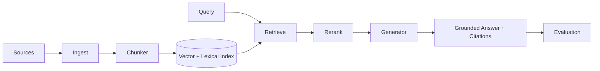

# Enterprise RAG Architecture

Reference architecture for **production RAG and enterprise knowledge systems**: ingestion, chunking, hybrid retrieval, grounding, citation, evaluation, and operational controls.

> Architecture kit demonstrating enterprise search + LLM answering patterns — not a hosted product.

## Architecture Focus

- Document ingestion and normalization pipelines
- Chunking strategies with metadata preservation
- Hybrid retrieval (lexical + vector)
- Grounded generation with citations
- Retrieval/answer evaluation hooks
- Access-control aware retrieval seams

## High-Level Architecture



## Key Capabilities

| Component | Responsibility |
|---|---|
| Ingest | Load docs, extract text, attach ACL/metadata |
| Chunker | Split with overlap and section awareness |
| Retriever | Hybrid candidate generation |
| Reranker | Precision boost over top-k |
| Generator | Answer with mandatory citations |
| Evaluator | Faithfulness / relevance scoring hooks |

## Technology Stack

- Python 3.11+
- FastAPI
- Pydantic
- pytest
- Pluggable vector store interface (in-memory for local demos)

## Setup

```bash
python -m venv .venv
source .venv/bin/activate  # Windows: .venv\Scripts\activate
pip install -r requirements.txt
cp .env.example .env
pytest
uvicorn src.api:app --reload
```

## Example Usage

```python
from src.pipeline.rag import RagPipeline

rag = RagPipeline()
rag.ingest_text("policy-1", "All vendor access requires quarterly review.")
result = rag.ask("How often must vendor access be reviewed?")
print(result.answer)
print(result.citations)
```

## Security Considerations

- Enforce document ACLs before retrieval
- Treat retrieved context as untrusted in prompts
- Redact secrets during ingestion
- Log query IDs without storing raw PII by default

## Known Limitations

- In-memory index for local reference only
- No production vector DB connectors bundled
- Generator uses deterministic stub without external LLM calls by default

## License

MIT
